<h1 align="center"></h1>

<table align="center" width="900">
  <tr>
    <td width="200" align="center" valign="middle">
      
    </td>
    <td width="680" valign="middle">
      <h3>Applied Geophysics · Seismic Inversion · Scientific Software</h3>
      
<strong>M.Sc. (Tech) in Applied Geophysics · IIT (ISM) Dhanbad · Class of 2027</strong>

      
I build Python tools for interpreting seismic, well-log, and geospatial data. My dissertation focuses on building initial velocity models for multiscale full-waveform inversion.

      

        
        
      

    </td>
  </tr>
</table>

  
  

---

## 🔬 Current research

> [!NOTE]
> **Multiscale full-waveform inversion (FWI)** · M.Sc. (Tech) dissertation  
> I build initial subsurface velocity models with implicit modeling and compare the recovered models and waveform fit on synthetic and Marmousi datasets.

## 🛠 Selected projects

| Project | What I built |
| --- | --- |
| **Formation Evaluation Software** | A Streamlit app for LAS well-log QC, interactive crossplots, Archie and Pickett water saturation, and NMR permeability estimation with core calibration. |
| **Seismic Velocity Analysis & NMO** | A workflow for processing wide-angle SEG-Y sonobuoy data from Vema V3607, picking velocities from semblance plots, and applying normal moveout correction. |
| **Gravity Inversion** | A synthetic gravity inversion workflow to detect buried bodies, with animations showing how the model changes during inversion. |

## 🏆 Competition results

- **🥇 Rank 1 · Kaggle Permeability Prediction (2025)** · Led a team that predicted permeability from well logs and evaluated the model on a separate test set.
- **🥈 Rank 2 · Prithvi ’26 Automatic Fault Detection, IIT Kharagpur × Rezlytix** · Led a team that built a training dataset from 3D seismic patches and used CNNs with self-supervised learning to estimate fault probabilities.

## 💼 Experience

- **Nath@crism** · Helped develop **RATNA**, a PyQt5 platform for natural hydrogen and critical mineral exploration. Built tools for georeferenced visualization, coordinate-system inspection, regression, and classification.
- **Sun Petrochemicals** · Built desktop software for preliminary interpretation of **3D seismic volumes up to 7 GB** on a low-specification PC.
- **NISER Bhubaneswar** · Used SIFT, ORB, and descriptor matching to identify and compare lunar surface features in Chandrayaan-2 IIRS imagery.

## ⚙️ Tools I use

  
  
  
  
  

**Analysis & visualization** · SciPy, Pandas, scikit-learn, Matplotlib, Plotly  
**Geophysical & spatial data** · ObsPy, lasio, GeoPandas, SEG-Y, LAS  
**Apps & computer vision** · Django, PyQt5, SIFT, ORB

## 🐍 Contribution activity

